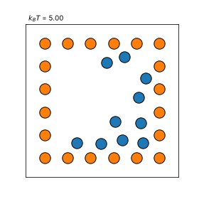
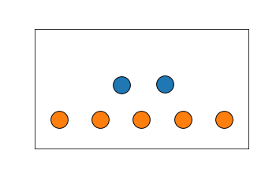
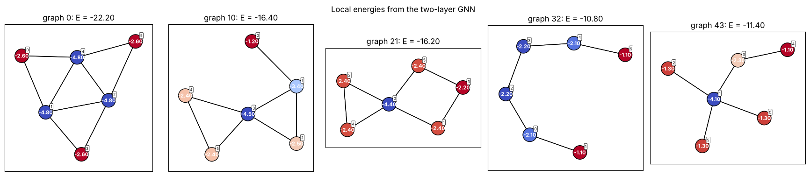
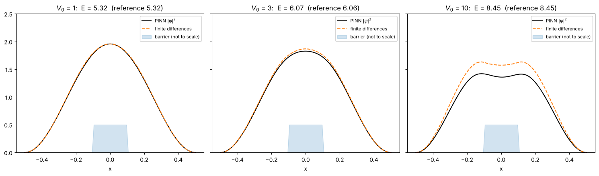

# Computational Physics

My solutions to the exercises in **Computational Physics** at Aarhus University
(autumn 2024). The course goes from Monte Carlo methods and molecular dynamics
to machine learning for atomic systems: regression, neural networks, graph
neural networks and physics-informed neural networks, all implemented in
Python with NumPy and PyTorch.

During the course I worked in two very long notebooks. This repository is
a cleaned-up version: **one notebook per exercise**, grouped by week, with the
code that several exercises share collected in a small, tested Python package,
[`comphy`](src/comphy).

<p align="center">
  
  
</p>
<p align="center">
  <br>
  
</p>
<p align="center"><sub>Simulated annealing (ex. 28) · molecular dynamics (ex. 26) · local energies from a graph neural network (ex. 62) · a physics-informed neural network solving the Schrödinger equation (ex. 67)</sub></p>

## Contents

### Week 2 – Monte Carlo sampling
| # | Notebook | Topic |
|---|---|---|
| 6 | [Direct sampling](notebooks/week02_monte_carlo_sampling/ex06_direct_sampling.ipynb) | rejection sampling of the Boltzmann distribution, thermal averages |
| 7 | [Reweighting](notebooks/week02_monte_carlo_sampling/ex07_reweighting.ipynb) | non-Boltzmann sampling and the effective sample size |
| 8 | [Metropolis](notebooks/week02_monte_carlo_sampling/ex08_metropolis.ipynb) | random-walk vs uniform proposals, convergence with chain length |
| 9 | [Rugged potentials](notebooks/week02_monte_carlo_sampling/ex09_rugged_potentials.ipynb) | staircase and double-Gaussian potentials |
| 10 | [Temperature dependence](notebooks/week02_monte_carlo_sampling/ex10_temperature_dependence.ipynb) | energy vs entropy in a two-well system |

### Week 3 – Monte Carlo and optimisation of clusters
| # | Notebook | Topic |
|---|---|---|
| 11 | [Metropolis trajectory](notebooks/week03_cluster_optimisation/ex11_metropolis_trajectory.ipynb) | following a walker on a rugged landscape |
| 12 | [Zero-temperature quench](notebooks/week03_cluster_optimisation/ex12_zero_temperature_quench.ipynb) | Monte Carlo relaxation of a Lennard-Jones atom |
| 13 | [Finite-temperature Monte Carlo](notebooks/week03_cluster_optimisation/ex13_finite_temperature_quench.ipynb) | small clusters at $k_BT = 0.15$ |
| 14 | [Line search](notebooks/week03_cluster_optimisation/ex14_line_search.ipynb) | steepest descent with line minimisation |
| 15 | [Random starts and particle swarms](notebooks/week03_cluster_optimisation/ex15_random_search_and_swarms.ipynb) | simple global optimisation |

### Week 4 – Descriptors and unsupervised learning
| # | Notebook | Topic |
|---|---|---|
| 18 | [Distance moments](notebooks/week04_descriptors_and_unsupervised_learning/ex18_distance_moments.ipynb) | a first cluster descriptor |
| 19 | [Neighbour counts and k-means](notebooks/week04_descriptors_and_unsupervised_learning/ex19_neighbour_count_and_kmeans.ipynb) | clustering in descriptor space |
| 20 | [More descriptors](notebooks/week04_descriptors_and_unsupervised_learning/ex20_more_descriptors.ipynb) | pair distances, coordination numbers, graph and Coulomb spectra |
| 21 | [PCA](notebooks/week04_descriptors_and_unsupervised_learning/ex21_pca.ipynb) | PCA from scratch, a map of all clusters |
| 22 | [k-means and DBSCAN](notebooks/week04_descriptors_and_unsupervised_learning/ex22_kmeans_and_dbscan.ipynb) | k-means from scratch, density-based clustering |

### Week 5 – Molecular dynamics
| # | Notebook | Topic |
|---|---|---|
| 24 | [Velocity Verlet](notebooks/week05_molecular_dynamics/ex24_velocity_verlet.ipynb) | NVE dynamics and a stochastic thermostat |
| 25 | [Double well](notebooks/week05_molecular_dynamics/ex25_double_well.ipynb) | Monte Carlo vs MD across a barrier |
| 26 | [Atoms on a surface](notebooks/week05_molecular_dynamics/ex26_cluster_dynamics.ipynb) | energy conservation, animation |
| 27 | [Heat capacity](notebooks/week05_molecular_dynamics/ex27_heat_capacity.ipynb) | melting / dissociation of a three-atom cluster |
| 28 | [Simulated annealing](notebooks/week05_molecular_dynamics/ex28_simulated_annealing.ipynb) | slow cooling of atoms in a box |

### Week 6 – Regression
| # | Notebook | Topic |
|---|---|---|
| 29 | [Least squares](notebooks/week06_regression/ex29_least_squares.ipynb) | polynomial OLS regression |
| 30 | [Ridge regression](notebooks/week06_regression/ex30_ridge_regression.ipynb) | regularisation |
| 31 | [Kernel ridge regression](notebooks/week06_regression/ex31_kernel_ridge_regression.ipynb) | polynomial and Gaussian kernels |
| 32 | [Lennard-Jones regression](notebooks/week06_regression/ex32_lennard_jones_regression.ipynb) | choosing physically motivated basis functions |
| 33 | [Kernel trick](notebooks/week06_regression/ex33_kernel_trick.ipynb) | kernels as inner products in feature space |
| 34 | [Learning an energy landscape](notebooks/week06_regression/ex34_learning_an_energy_landscape.ipynb) | why symmetric descriptors generalise |

### Week 7 – Global optimisation and periodic systems
| # | Notebook | Topic |
|---|---|---|
| 36 | [Basin hopping and PBC](notebooks/week07_global_optimisation_and_periodic_systems/ex36_basin_hopping_and_pbc.ipynb) | global optimisation, minimum-image convention, 2D crystals |
| 38 | [LJG global minimum](notebooks/week07_global_optimisation_and_periodic_systems/ex38_ljg_cluster_global_minimum.ipynb) | basin hopping on a Lennard-Jones-Gauss cluster |

### Week 8 – Automatic differentiation
| # | Notebook | Topic |
|---|---|---|
| 41 | [Polynomial derivatives](notebooks/week08_automatic_differentiation/ex41_polynomial_derivatives.ipynb) | first and second derivatives with `torch.autograd` |
| 42 | [Physical functions](notebooks/week08_automatic_differentiation/ex42_autodiff_functions.ipynb) | Gaussian, Fermi–Dirac and Lennard-Jones-Gauss derivatives |
| 43 | [Gradients in 2D](notebooks/week08_automatic_differentiation/ex43_gradient_2d.ipynb) | gradient field of Himmelblau's function |
| 44 | [Fitting with PyTorch](notebooks/week08_automatic_differentiation/ex44_fitting_with_torch.ipynb) | parabola, Gaussian and circle fits as `nn.Module`s |
| 45 | [Gaussian fit](notebooks/week08_automatic_differentiation/ex45_gaussian_fit.ipynb) | choice of parameters and starting guesses, local minima |
| 46 | [Bead-spring chains](notebooks/week08_automatic_differentiation/ex46_bead_spring_model.ipynb) | energy minimisation of springs with and without gravity |
| 47 | [LJG cluster](notebooks/week08_automatic_differentiation/ex47_ljg_cluster_optimisation.ipynb) | multi-start optimisation of a 12-atom cluster |

### Week 9 – Neural networks
| # | Notebook | Topic |
|---|---|---|
| 48 | [Simple networks](notebooks/week09_neural_networks/ex48_simple_networks.ipynb) | from a single weight to a hidden ReLU layer; dead ReLUs |
| 49 | [Activation functions](notebooks/week09_neural_networks/ex49_activation_functions.ipynb) | ReLU, Leaky ReLU, SiLU, Softplus |
| 50 | [Learning a rotation](notebooks/week09_neural_networks/ex50_learning_a_rotation.ipynb) | linear layers, and why the bias matters |

### Week 10 – Training neural networks
| # | Notebook | Topic |
|---|---|---|
| 51 | [Noisy pair potential](notebooks/week10_training_neural_networks/ex51_fitting_a_noisy_potential.ipynb) | network width, depth and activation |
| 52 | [Overfitting](notebooks/week10_training_neural_networks/ex52_overfitting_and_weight_decay.ipynb) | weight decay as regularisation |
| 53 | [Train / validation / test](notebooks/week10_training_neural_networks/ex53_train_validation_test.ipynb) | `DataLoader`s and early stopping |
| 54 | [Cluster energies](notebooks/week10_training_neural_networks/ex54_learning_cluster_energies.ipynb) | learning a pair potential: fitted LJG vs. neural network |

### Week 11 – Classification
| # | Notebook | Topic |
|---|---|---|
| 55 | [Softmax and cross-entropy](notebooks/week11_classification/ex55_softmax_and_cross_entropy.ipynb) | probabilities, surprise and the cross-entropy loss |
| 56 | [Classification in 2D](notebooks/week11_classification/ex56_classification_in_2d.ipynb) | linear vs. non-linear decision boundaries |
| 57 | [Labelled clusters](notebooks/week11_classification/ex57_labelled_clusters.ipynb) | exploring a labelled dataset |
| 58 | [Atom classification](notebooks/week11_classification/ex58_atom_classification.ipynb) | radial descriptors + classifier for atomic labels |

### Week 12 – Graphs and message passing
| # | Notebook | Topic |
|---|---|---|
| – | [Graphs in PyTorch Geometric](notebooks/week12_graphs_and_message_passing/ex00_graphs_in_pytorch_geometric.ipynb) | lecture notes: `Data`, adjacency, batching, aggregation |
| 59 | [Random graphs](notebooks/week12_graphs_and_message_passing/ex59_random_graphs.ipynb) | generating graphs and detecting duplicates by their spectrum |
| 60 | [Message passing](notebooks/week12_graphs_and_message_passing/ex60_message_passing.ipynb) | information spreading through a graph |
| 61 | [Learning node degree](notebooks/week12_graphs_and_message_passing/ex61_learning_node_degree.ipynb) | trainable ψ and φψ message-passing layers |

### Week 13 – Graph neural networks
| # | Notebook | Topic |
|---|---|---|
| 62 | [GNN cluster energies](notebooks/week13_graph_neural_networks/ex62_gnn_cluster_energies.ipynb) | total energy as a sum of local energies; deeper and wider GNNs |
| 63 | [Pyroxene](notebooks/week13_graph_neural_networks/ex63_pyroxene_gnn.ipynb) | element embeddings, edge weights and learned atomic representations |

### Week 14 – Physics-informed neural networks
| # | Notebook | Topic |
|---|---|---|
| 64 | [First-order ODE](notebooks/week14_physics_informed_neural_networks/ex64_first_order_ode.ipynb) | PINN for $y' = 0.9\cos(x)\,y^2$ |
| 65 | [Gaussian from ODEs](notebooks/week14_physics_informed_neural_networks/ex65_gaussian_from_odes.ipynb) | first- and second-order equations, boundary conditions |
| 67 | [Particle in a box](notebooks/week14_physics_informed_neural_networks/ex67_particle_in_a_box.ipynb) | Schrödinger equation as an eigenvalue problem, with a barrier |

## Repository layout

```
computational-physics/
├── notebooks/           one folder per week, one notebook per exercise
├── src/comphy/          shared helper code imported by the notebooks
├── data/                datasets handed out in the course
├── figures/             selected figures used in this README
├── requirements.txt
└── pyproject.toml
```

### The `comphy` package

| Module | What it contains |
|---|---|
| `montecarlo` | rejection sampling, Metropolis chains, exact thermal averages |
| `atoms` | NumPy Lennard-Jones(-Gauss) potentials with forces (optionally periodic), clusters, Monte Carlo quench and line-search relaxation |
| `md` | velocity Verlet and a velocity-resampling thermostat (also for simulated annealing) |
| `regression` | OLS / ridge regression and kernel ridge regression |
| `plotting` | consistent axis styling, parity plots, loss curves |
| `models` | `MLP` – a configurable fully connected network |
| `training` | `fit` (full-batch) and `train` (mini-batch, validation, early stopping) loops that work for both tensors and graphs |
| `potentials` | Lennard-Jones-Gauss pair potential (fixed or trainable) and a neural-network pair potential |
| `clusters` | random 2D clusters and a function to draw them |
| `descriptors` | cluster descriptors (distance moments, neighbour counts, spectra, …) and a radial per-atom descriptor |
| `graphs` | building, comparing and drawing graphs; message-passing layers (PyTorch Geometric) |
| `pinn` | physics-informed neural network and a generic training loop for 1D ODEs |

## Getting started

```bash
git clone https://github.com/Jeppe-thybo/Computational-Physics.git
cd Computational-Physics
python -m venv .venv && source .venv/bin/activate   # Windows: .venv\Scripts\activate
pip install -r requirements.txt                     # also installs comphy in editable mode
jupyter lab
```

The notebooks are saved with their outputs, so they can also be read directly
on GitHub without running anything. Random seeds are fixed, but exact numbers
can differ slightly between library versions. Run the tests with `pytest`.

## About this rewrite

The original work lived in two notebooks of about 450 cells. Going from there
to this repository involved:

* splitting the work into one self-contained notebook per exercise, each with
  a short explanation of the physics and the method;
* replacing a dozen near-identical model classes and copy-pasted training loops
  with a few shared functions (`MLP`, `fit`, `train`, `train_pinn`, …);
* re-running every notebook from top to bottom with fixed random seeds;
* fixing bugs found along the way – for example Gaussian fits that were never
  actually trained because the optimiser pointed at another model's parameters
  (ex. 45), a wrong formula for the Lennard-Jones-Gauss potential (ex. 38) and a
  shape-broadcasting error in a GNN loss (ex. 62) – and replacing a few
  fragile tricks with more robust methods (an exact boundary condition in the
  Schrödinger PINN, a bounded line search, analytic gradients for basin hopping).

Week 1 (Python warm-up exercises) is not included.
